# DE10-Nano Robotic Arm Teleoperation

A two-board robotic-arm control project using **Terasic DE10-Nano**, **Cyclone V FPGA + ARM HPS**, two analog joysticks, and **Firebase Realtime Database**.

The transmitter (TX) reads joystick inputs and publishes joint targets. The receiver (RX) reads cloud commands and generates six independent FPGA PWM signals for the arm. Each board can reach the internet through an ESP32/W5500 gateway or Linux laptop Ethernet sharing.

## Documentation and source

Start with the receiver guide, then configure the transmitter.

| Resource | Contents |
|---|---|
| [Complete RX guide](DE10_Nano_RX_Complete_Guide.pdf) | Platform Designer, Verilog, pin assignments, servo wiring, Firebase setup, Linux configuration and startup |
| [Complete TX guide](DE10_Nano_TX_Complete_Guide.pdf) | ADC acquisition, joystick wiring, incremental control, FPGA build, Firebase publishing and complete Python scripts |
| [RX source package](RX_Companion.zip) | Receiver FPGA source, RBF, Python programs and configuration templates |
| [TX source package](TX_Companion.zip) | Original FPGA project, corrected rebuild source, historical RBF, Python programs and validation reports |

Both PDFs also contain their corresponding source archive as an attachment. Use the ZIP files for source code rather than copying visually wrapped lines from a PDF. Each package includes a SHA-256 manifest.

## Architecture

```mermaid
flowchart LR
    J[Two joysticks] --> ADC[TX onboard ADC and FPGA inputs]
    ADC --> TP[TX input PIO registers]
    TP --> TH[TX HPS: Python controller]
    TH -->|HTTPS through Ethernet gateway| FB[Firebase Realtime Database]
    FB -->|Event stream through Ethernet gateway| RH[RX HPS: Python receiver]
    RH --> RP[RX PIO registers]
    RP --> PWM[FPGA: six PWM channels]
    PWM --> ARM[Six-servo robotic arm]
```



The HPS handles networking and application logic. The FPGA handles input acquisition on TX and servo pulse timing on RX. The ESP32/W5500 provides network access; it does not generate servo PWM.

## Features

- Four joystick axes control base, shoulder, elbow and wrist pitch.
- Incremental control: moving a stick changes its target angle; releasing it holds the target.
- JS1 push-button toggles the claw open/closed.
- Wrist roll is supported by RX but is not joystick-controlled in the current TX implementation.
- Six independent RX PWM outputs at 50 Hz using a 50 MHz FPGA clock.
- Firebase authentication with separate TX writer and RX reader accounts.
- Persistent HTTPS connections in the final TX publisher.
- Saved credentials and a one-command RX launcher after initial setup.
- Manual Firebase-console control for testing RX without a TX board.

## Hardware and software

| Component | Configuration used |
|---|---|
| FPGA boards | Two DE10-Nano boards, Cyclone V `5CSEBA6U23I7` |
| Inputs | Two analog joystick modules with X, Y and push-button outputs |
| Large servos | Three TowerPro MG996R: base, shoulder and elbow |
| Small servos | Three TowerPro MG90S: wrist pitch, wrist roll and claw |
| Servo power | Separate regulated 5 V supply sized for the motors and mechanical load |
| Networking | Configured ESP32/W5500 gateway or Linux laptop internet sharing |
| FPGA tools | Quartus Prime 25.1std/Lite with Cyclone V support and Platform Designer |
| Development host | Linux with PuTTY or another serial terminal |
| Recorded board OS | Angstrom v2014.12, Linux 4.5.0, Python 2.7.3 |
| Recorded HTTPS runtime | curl 7.37.1 and libcurl; see guides for exact dependencies |
| Cloud | Firebase Realtime Database and Email/Password Authentication |

**Boot-image dependency:** a compatible DE10-Nano Linux SD image and bootloader are required. The source packages do not include the operating-system image or ESP32 router firmware. An RBF alone cannot boot a blank SD card. The archived HPS settings must not be used blindly to generate a new preloader; the guides document differences from the running boot environment.

## TX joystick connections

| Input | Connection | Action |
|---|---|---|
| JS1 VRx | Arduino A0 / ADC_IN0 | Shoulder |
| JS1 VRy | Arduino A1 / ADC_IN1 | Base |
| JS2 VRx | Arduino A2 / ADC_IN2 | Elbow |
| JS2 VRy | Arduino A3 / ADC_IN3 | Wrist pitch |
| JS1 SW | JP1 physical pin 1 / FPGA V12 | Claw toggle |
| JS2 SW | Unused by current controller | No assigned control action |
| Joystick VCC | Regulated 3.3 V | Supply |
| Joystick GND | Common supply/board ground | Reference |

The ADC serial signals are already connected on the board. Connect joystick analog outputs to A0–A3, not directly to those SPI signals. If using an external joystick supply, share ground without joining two regulated positive supply outputs.

## RX servo connections

| Joint | JP1 physical signal pin | FPGA ball | Pulse range used |
|---|---:|---|---|
| Base | 1 | V12 | 600–2400 µs |
| Shoulder | 2 | E8 | 600–2400 µs |
| Elbow | 3 | W12 | 600–2600 µs |
| Wrist pitch | 4 | D11 | 420–2380 µs |
| Wrist roll | 5 | D8 | 420–2380 µs |
| Claw | 6 | AH13 | 400–1200 µs |

Connect servo power to the external 5 V supply and connect its ground to board ground, such as JP1 pin 12 or 30. Do not power the motors through FPGA GPIO pins. Locate the header's pin-1 marking before wiring. These pulse ranges are specific to the recorded assembly; verify mechanical limits before using them on another arm.

## Setup sequence

1. Download both guides and source packages. Preserve an existing working SD card before changing its boot files.
2. Build/configure **RX first**, following its guide through Platform Designer, Verilog, constraints and RBF loading.
3. Confirm Linux boot, FPGA bridge access and internet connectivity on RX.
4. Create your Firebase project, enable Email/Password Authentication, create separate reader/writer accounts, and apply rules using their actual UIDs.
5. Initialize `/rx_arm/command` using the guide's schema. Install the RX software and private configuration.
6. Test one servo at a time, then verify all six through Firebase.
7. Configure TX using its guide. Verify the four ADC inputs and JS1 switch before enabling publishing.
8. Install the TX Python files and run the authentication setup helper once.
9. Test TX-to-Firebase updates with RX motor power off, then perform controlled end-to-end movement tests.

These are navigation steps, not a replacement for the detailed build and boot instructions in the PDFs. The software targets the recorded Python 2.7 board environment; a modern OS may require changes to Python, FPGA loading and `/dev/mem` access.

### Normal startup after configuration

On **RX**, through its terminal:

```sh
python /home/root/start_rx.py
```

On **TX**, through its terminal:

```sh
python -u /home/root/tx_control.py
```

Release the joysticks and switches during calibration. Review the starting targets, then type `START` when prompted. TX enables the five controlled joints; wrist roll retains its existing state. Credentials do not need to be entered on each start once saved successfully.

Stopping TX with `Ctrl+C` does **not** disable RX servo outputs. RX retains its last received target. Use the documented RX shutdown/disable procedure when PWM must stop.

## Firebase command format

Commands are stored at:

```text
/rx_arm/command
```

```json
{
  "seq": 0,
  "sent_ms": 0,
  "angles": [90, 90, 90, 90, 90, 0],
  "enable": [false, false, false, false, false, false]
}
```

Array order is **base, shoulder, elbow, wrist pitch, wrist roll, claw**. This example is an initialization object with all outputs disabled, not a fresh live command. The publisher generates sequence and timestamp values. Follow the guide for the selected receiver mode and freshness checks.

Only one publisher should own the command object at a time. Stop TX before manually editing targets in the Firebase console, otherwise TX will overwrite them.

## Validation and performance

| Area | Recorded result |
|---|---|
| RX manual cloud control | User confirmed movement of all six servos through Firebase |
| RX startup | User confirmed one-command launcher operation after reboot |
| TX input acquisition | Four ADC channels and JS1 switch verified |
| TX publishing | Authenticated updates to Firebase verified |
| Corrected TX FPGA source | Synthesis, fitting and timing analysis completed; warnings documented |
| Corrected TX image on hardware | Not tested on the board during report preparation |
| Complete TX-to-RX motion latency | Not established by the recorded TX tests |

The recorded final TX test observed a median Firebase write duration of approximately **140 ms**, with a nearest-rank 95th percentile of **165 ms** over 478 writes. This measures a write request, not joystick-to-servo latency. A consistent 50–150 ms end-to-end response is a target, not a demonstrated guarantee.

The controller is open-loop: commanded angles are not measured joint positions. Network loss can leave the arm holding its previous target. The current implementation has no independent emergency-stop watchdog.

## Original and corrected TX sources

The TX source folder deliberately separates:

- `Original_FPGA/`: the user-identified Desktop project and historical RBF.
- `Rebuild_FPGA/`: documented corrections to the reset-port binding, DDR ODT width/pin constraints, ADC I/O voltage standards, explicit source inclusion, clock constraint and power-on reset.
- `software/`: final TX controller, persistent libcurl transport, setup helper, diagnostics and credential-free templates.
- `reference/`: Platform Designer exports, build reports and pin comparison results.

Passing synthesis or timing analysis does not prove a newly generated image works on the physical board. Review warnings and complete the guide's hardware acceptance checks before replacing a working image.

## Repository contents

- `RX_Companion.zip` and `TX_Companion.zip` (extract to access the source folders): FPGA and software sources, configuration templates and validation reports.
- RX and TX PDF guides: detailed implementation instructions.
- `Group A1 Thesis.pdf`: project thesis.
- `Project_Poster(2).pdf`: project poster.
- `ESP32-W5500 ROUTER.pdf`: reformatted router guide with Wi-Fi credentials replaced by placeholders.

Raw PuTTY logs, temporary Quartus databases and redundant build outputs are excluded from the public upload. Keep populated credential configurations, tokens and Wi-Fi passwords out of Git. Original Desktop files were not changed.

## License


